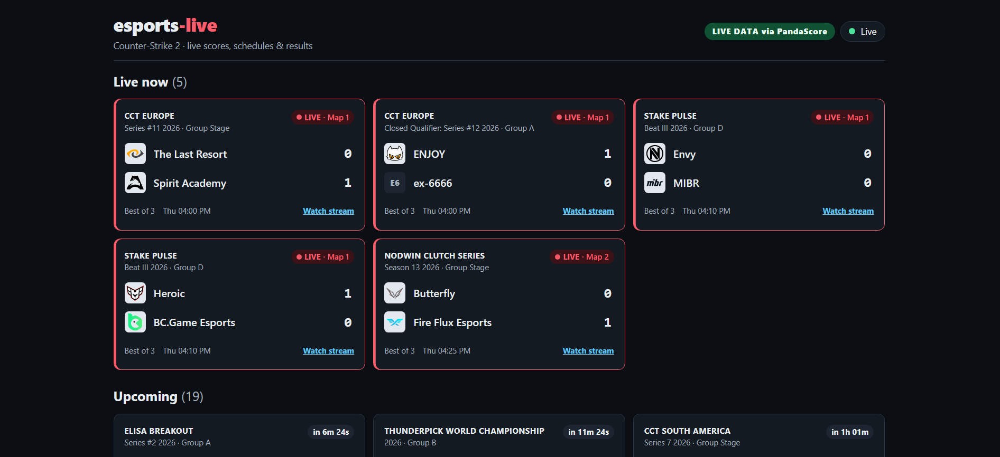

# esports-live

esports-live is a real-time dashboard that shows live CS2 matches, schedules and results. A Node.js WebSocket
server pulls data from the PandaScore API and pushes updates to a React client, which detects dead connections
with a heartbeat and reconnects automatically. I built it to learn real-time systems, testing and deployment,
working the way a team does: issues, branches, pull requests and CI.

- Real data comes from the [PandaScore](https://pandascore.co) REST API, using the free *Schedules, Results & Context Data* plan.
- Without a token, a built-in **demo data** source plays out fake matches so the UI still works offline. The UI always labels which source is active.

## Live demo

**https://cs2-project-two.vercel.app**



The server runs on a free plan that sleeps when idle, so the first load after a period of inactivity can take
about a minute while it wakes up. The page shows a "server is waking up" message in the meantime.

## Why native WebSockets?

- **One-way push is all we need.** The server broadcasts snapshots and diffs and clients only listen. The
  `ws` library plus the browser's built-in `WebSocket` cover that without Socket.io's protocol, client bundle
  or fallbacks.
- **Explicit control.** Heartbeats (ping/pong), maximum payload size, per-IP connection limits, Origin checks,
  backpressure and graceful close are each a few visible lines in [`server/src/wsHub.ts`](server/src/wsHub.ts) rather than
  framework defaults.
- **Typed protocol.** Messages are defined once with zod in [`shared/`](shared/src/protocol.ts) and validated on both
  ends: the server refuses to send a malformed frame and the client ignores one.

## Architecture

- **Client:** a React + Vite single-page app, hosted as static files on Vercel.
- **Server:** a Node.js process (Express + `ws`) on Render. It polls PandaScore, keeps the current state and
  holds a long-lived WebSocket to every browser.
- **Data:** the PandaScore REST API (free plan), normalized into one `Match` model; demo fixtures are used when
  no token is set.
- **Updates:** a new client gets a full `snapshot`, then only `diff` messages with the matches that changed.
- **Dead connections:** the server sends a `heartbeat` message, and the client runs a watchdog that reconnects
  when the connection goes silent (details below).

```
                          (every POLL_INTERVAL_MS, budgeted & cached)
  ┌──────────────────┐   HTTPS + Authorization: Bearer   ┌──────────────────────────────────────┐
  │ PandaScore REST  │ ◄──────────────────────────────── │  server (Node + Express + ws)        │
  │  /csgo/matches/  │ ────────────────────────────────► │                                      │
  │  running|upcoming│        JSON (validated by zod)    │  MatchSource (adapter)               │
  │  |past           │                                   │   ├─ PandaScoreSource ─┐  normalize  │
  └──────────────────┘                                   │   └─ FixtureSource ────┴─► Match[]   │
                                                         │                │                     │
                                                         │  Poller ── diff vs MatchStore        │
                                                         │      │  (stale=true on failure,      │
                                                         │      │   exponential backoff)        │
                                                         │      ▼                               │
                                                         │  WsHub  /ws   ── GET /health         │
                                                         └──────┬───────────────────────────────┘
                                         snapshot on connect,   │  native WebSocket
                                         then diff / status     │  (Origin check, heartbeat,
                                                                ▼   max payload, per-IP limit)
                                                   ┌──────────────────────────────┐
                                                   │ client (React + Vite)        │
                                                   │  useLiveMatches: reconnect   │
                                                   │  w/ backoff + jitter, status │
                                                   │  Scoreboard + aria-live      │
                                                   └──────────────────────────────┘
```

| Folder    | What's inside |
| --------- | ------------- |
| `shared/` | `Match` model and WebSocket message types (`snapshot`, `diff`, `status`, `error`, `heartbeat`), plus zod validators |
| `server/` | Express + `ws` server, `MatchSource` adapters, poll/diff loop, rate-limit and backoff logic, token redaction |
| `client/` | React + TypeScript + Vite UI in plain CSS with design tokens and no UI library |

### Wire protocol (server → client)

| `type`     | When | Payload |
| ---------- | ---- | ------- |
| `snapshot` | Immediately after connecting, and after a source switch | `source`, `stale`, `lastUpdated`, `message`, all `matches`, optional `heartbeatMs` |
| `diff`     | After a poll that changed something | `upserted: Match[]`, `removed: id[]` |
| `status`   | Freshness or source changed (e.g. upstream down, so `stale: true`) | `source`, `stale`, `lastUpdated`, `message` |
| `error`    | Server-side problem worth showing | `code`, `message` |
| `heartbeat` | Every `HEARTBEAT_MS`, so clients can tell a quiet server from a dead connection | `serverTime` |

Every message carries `v: 1`, the protocol version.

### Dead connection detection

Browsers can't see WebSocket ping frames, so a silently dropped connection (laptop sleep, a proxy timing
out) could leave the UI showing "Live" with frozen data. The server therefore sends a `heartbeat` message
every `HEARTBEAT_MS` and announces that interval as `heartbeatMs` in every snapshot. The client runs a
watchdog: after 3 × `heartbeatMs` without a valid message (and immediately when a backgrounded tab becomes
visible again), it drops the socket, shows "Reconnecting…" and reconnects with backoff, then receives a
fresh snapshot. If a snapshot has no `heartbeatMs` (an older server that sends no heartbeats), the client
never arms the watchdog, so healthy connections aren't cut.

## Design decisions

- **Heartbeat as an application-level message:** browsers can't see WebSocket ping frames, so the client
  needs a real message to know the connection is alive.
- **Watchdog at 3 × `heartbeatMs`:** a few missed heartbeats are tolerated on slow networks, and the client
  clamps the interval the server announces to 5–60 s so a bad value can't cause reconnect loops.
- **Backward compatible:** if a snapshot has no `heartbeatMs` (an older server without heartbeats), the
  watchdog stays off so healthy connections aren't cut.
- **Reconnect without waiting for `onclose`:** a dead socket may never deliver its close event, so the client
  detaches it, closes it and schedules the reconnect itself.
- **Render + Vercel instead of serverless:** a long-lived WebSocket doesn't fit serverless functions, so the
  server runs as a normal web service and only the static client goes to Vercel.

## Running locally

Requirements: Node 20 or newer (developed on Node 24) and npm 10 or newer.

```bash
npm install

# optional: real data
cp server/.env.example server/.env    # then set PANDASCORE_TOKEN=... in server/.env

npm run dev            # server on :3001 and client on :5173 together
# or run them separately:
npm run dev -w server
npm run dev -w client
```

Open http://localhost:5173. Check the server with `curl http://localhost:3001/health`.

Other scripts (run from the repo root):

```bash
npm run lint        # ESLint (flat config) over all workspaces
npm run typecheck   # tsc --noEmit in shared, server and client
npm test            # Vitest in shared, server and client (no network access)
npm run build       # server -> server/dist (tsup), client -> client/dist (vite)
npm start           # run the built server
```

## Environment variables

Server (`server/.env`, loaded with dotenv; see `server/.env.example`):

| Variable | Default | Purpose |
| -------- | ------- | ------- |
| `PANDASCORE_TOKEN` | *(empty)* | PandaScore API token. If set, live data is used; if empty, demo fixtures. **Server only.** |
| `PORT` | `3001` | HTTP and WebSocket port |
| `POLL_INTERVAL_MS` | `30000` | Upstream poll interval. Values below 10,000 are raised to 10,000. |
| `ALLOWED_ORIGIN` | `http://localhost:5173` | Comma-separated list of origins allowed to open the WebSocket |
| `MAX_CONNECTIONS_PER_IP` | `10` | Concurrent WebSocket connections allowed per IP |
| `TRUST_PROXY` | `false` | Set `true` behind a reverse proxy so the per-IP limit uses `X-Forwarded-For` |
| `FORCE_SOURCE` | *(empty)* | `fixture` forces demo data even when a token is set |
| `FIXTURE_INTERVAL_MS` | `5000` | Tick interval for demo data (local only, no API cost) |
| `HEARTBEAT_MS` | `20000` | Interval of the WebSocket `heartbeat` message. Clamped to 5,000-60,000 with a logged warning. |
| `HOST` | *(all interfaces)* | Bind address |

Client (`client/.env`, see `client/.env.example`):

| Variable | Default | Purpose |
| -------- | ------- | ------- |
| `VITE_WS_URL` | `ws://<page host>:3001/ws` | WebSocket URL of the server. Anything `VITE_*` is public, so never put secrets here. |

## Deploy

- **Server → Render**, configured by [`render.yaml`](render.yaml) (free web service, health check on `/health`).
  Environment variables: `PANDASCORE_TOKEN` and `ALLOWED_ORIGIN` (entered in the Render dashboard, never in the
  repo), `TRUST_PROXY`, `HEARTBEAT_MS`, `POLL_INTERVAL_MS`. Render sets `PORT` itself.
- **Client → Vercel**, configured by [`vercel.json`](vercel.json) (built from the repo root because the client uses
  the `shared/` workspace). Environment variable: `VITE_WS_URL` (the server's `wss://…/ws` URL, set before
  building). A deploy build without it fails on purpose.
- **Order:** deploy the server first, then the client with the server's URL, then set `ALLOWED_ORIGIN` on the
  server to the client's exact URL and redeploy the server.

## Data sources (read this)

**PandaScore, free plan.** Facts checked against the official docs:

- Base URL `https://api.pandascore.co`. The token is sent as `Authorization: Bearer …` and never as the
  `?token=` query parameter, so it can't end up in URLs or logs.
- CS2 is still served under the **`/csgo`** slug. CS2 is selected with `filter[videogame_title]=cs-2`.
- Endpoints used: `/csgo/matches/running`, `/csgo/matches/upcoming`, `/csgo/matches/past`, first page only
  (`page[size]` up to 100).
- The free plan allows **1,000 requests/hour**. This app budgets itself to 600/hour (60%) and normally uses
  about **144/hour**: `running` on every 30 s poll, and `upcoming`/`past` cached for 5 minutes. It also reads
  `X-Rate-Limit-Remaining` and pauses if the provider reports fewer than 50 left, backs off exponentially on
  429/5xx (honouring `Retry-After`), and never polls faster than `POLL_INTERVAL_MS`.
- When the API fails, the server keeps serving the **last good state** with `stale: true`, and the UI shows
  an "out of date" notice. If the token is rejected (401/403), the server switches to demo data and says so.

**What the free plan does *not* give you.** It covers schedules and results: who plays whom and when, the
series score (maps won), best-of format, tournament and streams. **Real-time per-round data is not
available** on this plan, so there are no round scores, map names, player stats or kill feeds. Those need
PandaScore's paid real-time plans. Because data arrives by polling, a map result can show up in the UI up to
about 30 s after it happens.

**Fixtures are demo data.** `FixtureSource` generates fictional teams and tournaments on a repeating
schedule driven by the clock. They are always tagged `source: "fixture"` and shown with a **DEMO DATA**
badge. They are not real matches.

## Security notes

- The PandaScore token lives only in `server/.env`, which is git-ignored. It is never sent to the browser,
  logged, or included in tests or fixtures.
- Every log line passes through a redactor that masks the known token, plus any `token=` query parameter or
  `Bearer` credential.
- WebSocket hardening: Origin allow-list, 1 KB maximum inbound payload (clients don't need to send
  anything), per-IP connection cap, heartbeat that terminates dead peers, and disconnection of clients that
  fall too far behind (backpressure).
- Logo and stream URLs from the API are only passed to the browser if they are `http(s)` URLs.

## Accessibility

Semantic landmarks and headings, a skip link, visible focus styles, colour tokens checked against WCAG
AA in both dark and light schemes, a polite `aria-live` region that announces score changes, full
keyboard operation, `prefers-reduced-motion` support, and a responsive layout from 360px wide.

## Development workflow

Work is tracked as GitHub issues (the backlog is in [`docs/ISSUES.md`](docs/ISSUES.md)). Each issue gets its own
branch and pull request, commits follow Conventional Commits, and CI (lint, typecheck, test, build) must pass
before a pull request is merged. See [CONTRIBUTING.md](CONTRIBUTING.md) for the details.

The tests run with Vitest and never call the real API. They cover the message protocol, state diffing, token
redaction, rate limiting and backoff, PandaScore mapping (against saved sample responses), source selection and
config, the WebSocket hub (origin checks, connection limits, heartbeat), and on the client the reconnect logic,
the dead-connection watchdog and the scoreboard components.

## License

License: MIT. See [LICENSE](LICENSE).
